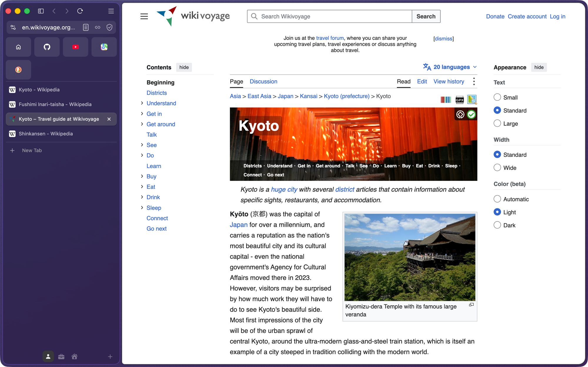
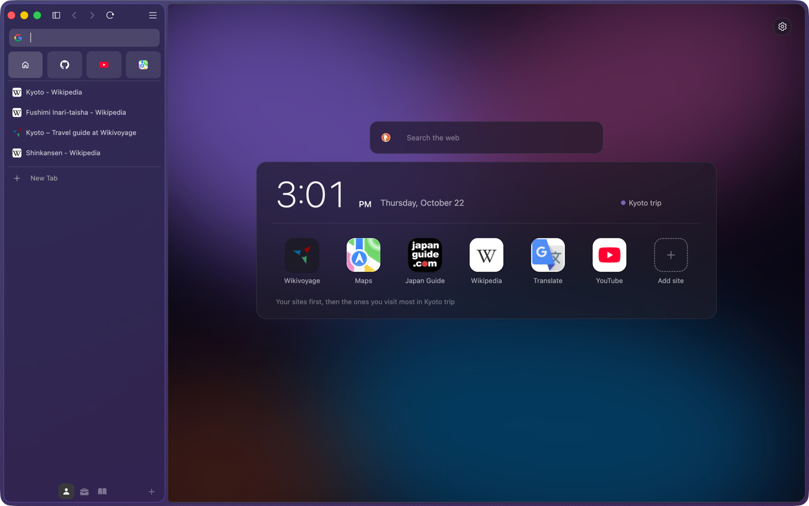
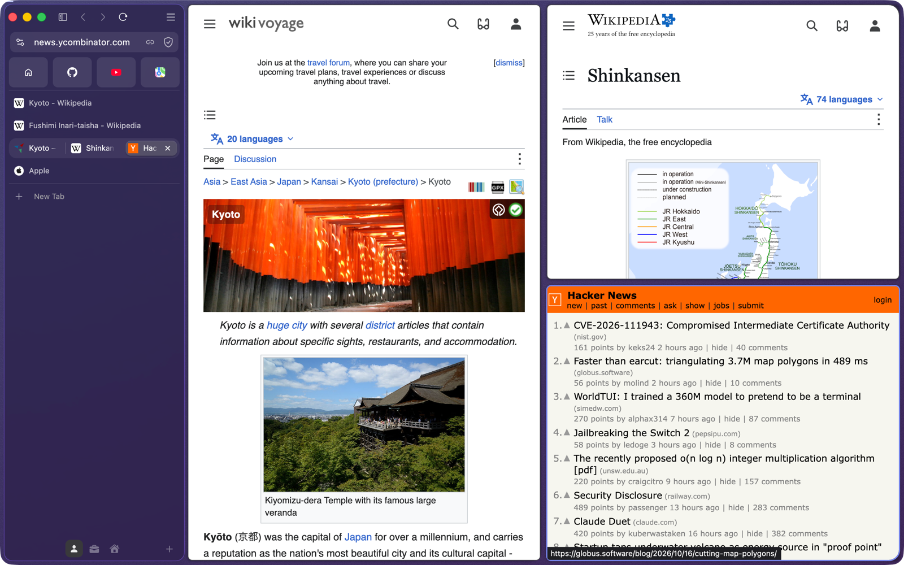
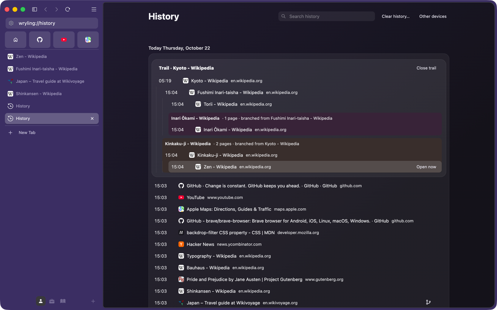
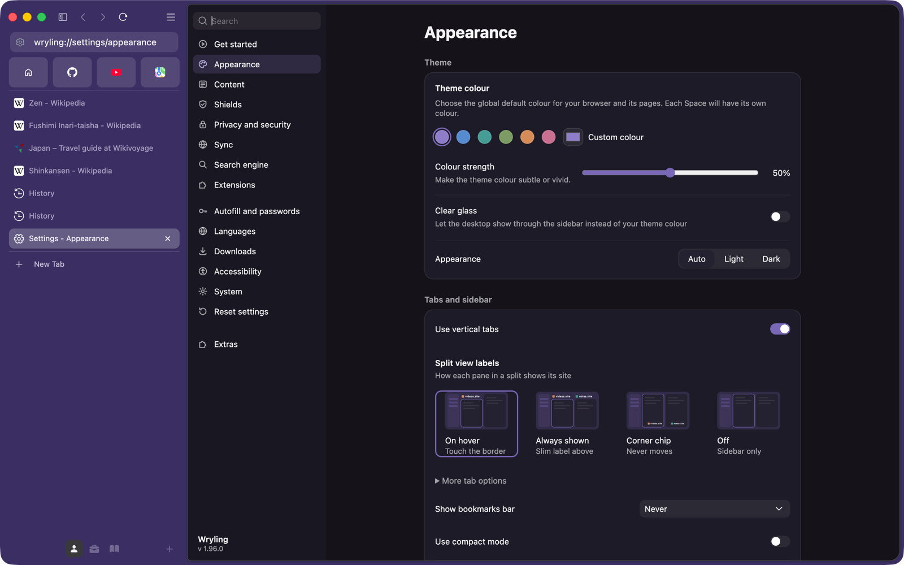
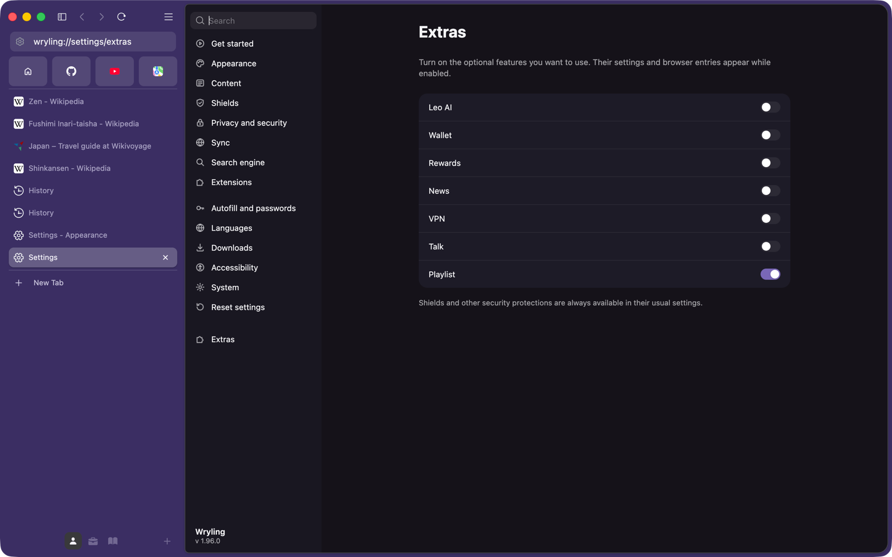

<p align="center">
  
</p>

<h1 align="center">Wryling</h1>

<p align="center">
  <b>A calm, sidebar-first browser for macOS.</b><br>
  Built on Brave and Chromium. Redesigned around the way you actually move between pages.
</p>

<p align="center">
  
  
  
  
  
</p>

<p align="center">
  <a href="#features">Features</a> ·
  <a href="#keyboard-and-gestures">Shortcuts</a> ·
  <a href="#privacy">Privacy</a> ·
  <a href="#building-from-source">Build</a> ·
  <a href="#faq">FAQ</a>
</p>

<br>

<picture>
  <source media="(prefers-color-scheme: dark)" srcset="./docs/images/wryling/hero-dark.png">
  <source media="(prefers-color-scheme: light)" srcset="./docs/images/wryling/hero-light.png">
  
</picture>

<p align="center"><sub>Wryling follows your Mac's appearance. This screenshot switches with GitHub's light and dark themes.</sub></p>

<br>

Most browsers stack a tab strip on a toolbar on top of the page, then fill the
toolbar with buttons for features you never asked for. Wryling takes all of
that away. Your address, favourites, tabs and spaces live in one tinted
sidebar on the left, the page gets the rest of the window, and anything that
isn't about browsing is switched off until you want it.

Under the hood it is still Chromium, with Brave's privacy work built in, so
sites work the way they do in Chrome, extensions from the Chrome Web Store
install as usual, and ads and trackers are blocked from the first page you open.

## At a glance

| | |
|---|---|
| **Sidebar** | Address, favourites, tabs and spaces in one panel. Hide it completely; it comes back when you touch the edge. |
| **Spaces** | Separate sets of tabs for each part of your life, each with its own name, icon, colour and Home page. |
| **Home** | A dashboard per space with a clock, search and big app-style icons for the sites you use there. |
| **Command bar** | <kbd>⌘T</kbd> opens a floating search over the page. No empty tab until you pick something. |
| **Split view** | Two to four pages side by side. Drag a tab onto the edge of the page to split. |
| **Trails** | History that remembers which page led to which, including the branches you backed out of. |
| **Extras off** | AI assistant, Wallet, VPN, Rewards, News and Talk are off, and gone from menus, until you turn them on. |
| **Shields** | Brave's ad and tracker blocking on every site, without needing Brave's servers. |

## Contents

- [Design principles](#design-principles)
- [Features](#features)
  - [The sidebar](#the-sidebar)
  - [Spaces](#spaces)
  - [Home](#home)
  - [Command bar](#command-bar)
  - [Split view](#split-view)
  - [Trails](#trails)
  - [Appearance](#appearance)
  - [Extras](#extras)
- [Keyboard and gestures](#keyboard-and-gestures)
- [Privacy](#privacy)
- [How Wryling differs from Brave](#how-wryling-differs-from-brave)
- [Building from source](#building-from-source)
- [Project layout](#project-layout)
- [Development](#development)
- [Status and roadmap](#status-and-roadmap)
- [FAQ](#faq)
- [Credits](#credits)
- [License](#license)

## Design principles

1. **The page comes first.** Browser chrome sits beside the page, never on top
   of it. When you don't need the sidebar, it gets out of the way entirely.
2. **One place for everything.** There is one address bar. It lives in the
   sidebar and moves into the command bar when you press <kbd>⌘T</kbd>.
3. **Quiet by default.** No promotions, no badges, no feature tours. Optional
   features are off until you ask for them.
4. **Feel like a Mac app.** System fonts and spacing, native materials, SF
   Symbols, trackpad gestures, and light and dark appearances that follow macOS.
5. **Nothing fake.** When something is turned off, it is actually off: its
   menus and settings pages go with it, and its services stay switched off.

## Features

### The sidebar

Everything the browser needs to show you lives in one panel on the left.

- **Address pill.** Shows the site, not the full URL. Click to edit. Next to it
  are a **copy link** button, which copies the page's address and confirms with
  a small toast, and the Shields icon, which shows only on pages Shields
  applies to.
- **Favourites.** Pinned tabs become a row of tiles at the top, each showing
  the site's own icon.
- **Tabs.** A vertical list with the current tab lifted off the background as a
  card. Pages in a split share one row, so they stay together.
- **Hide it completely.** The sidebar button by the window controls hides the
  sidebar, the traffic lights and all. Move the pointer to the window's left
  edge and it slides back over the page; move away and it hides again.
- **Drag the window from anywhere empty.** The strip above the page, the
  margins around it and the sidebar's free space all move the window, like any
  Mac app.

### Spaces

<table>
  <tr>
    <td align="center"><br><sub><b>Kyoto trip</b> · the theme colour</sub></td>
    <td align="center"><br><sub><b>Work</b> · violet</sub></td>
    <td align="center"><br><sub><b>Reading</b> · blue</sub></td>
  </tr>
</table>

A space is its own set of tabs: a trip you're planning, your work, the
articles you mean to read. Switching spaces swaps the whole tab list and
re-tints the window, so you always know where you are.

- **Name, icon and colour.** Choose from twenty SF Symbols and a set of
  colours, or keep the theme colour. Right-click a space to edit or delete it;
  click <kbd>+</kbd> to add one.
- **Switch however you like.** Click the icons at the bottom of the sidebar,
  press <kbd>⌃1</kbd> to <kbd>⌃9</kbd>, or swipe sideways with two fingers
  anywhere on the sidebar. The tab list slides in from the side you're heading
  to.
- **Move tabs between spaces** from the tab's right-click menu
  (**Move to space**).
- **Shortcuts stay local.** <kbd>⌘1</kbd> to <kbd>⌘9</kbd> count only the
  current space's tabs.
- **You land where you left off.** Coming back to a space reopens the tab you
  were on. Opening a tab that belongs to another space, for example with
  <kbd>⇧⌘T</kbd>, takes you to that space.
- **Shared across windows.** Every window of a profile sees the same spaces.

### Home



Each space has a Home tab pinned at the top of its list. It replaces the usual
New Tab page with a dashboard for that space.

- **Your sites, large.** Sites you add come first, then the sites you open most
  in that space. Wryling reads each site's web app manifest and home-screen
  icon, so tiles use the site's real app icon and short name rather than a
  blurry favicon. Icons are cached on disk.
- **A clock, the date and a search box**, plus a choice of eight built-in
  wallpapers: Aurora, Tint, Ribbon, Contours, Prism, Halo, Dusk and Mist.
- **Always there.** <kbd>⌘W</kbd> skips the Home tab, and anything you open from
  it (a tile, a search, a typed address) opens in a new tab of the same space,
  so Home is never navigated away.

### Command bar

Press <kbd>⌘T</kbd>, or click **New Tab** in the sidebar, and a floating glass
panel opens in the middle of the window with a search field and live
suggestions.

- **No empty tabs.** Nothing opens until you choose. Press <kbd>Return</kbd> or
  click a suggestion and it opens in a new tab; press <kbd>Esc</kbd> or click
  away and nothing has changed.
- **Search, go, or switch.** Type a search, an address, or part of a page title.
  Pages you already have open show **Switch to this tab** instead of opening a
  duplicate.
- **Still one address bar.** The panel is the sidebar's own address bar,
  enlarged. It moves into the panel and back, so history, suggestions and
  settings are exactly the same in both places.

### Split view



- **Drag to split.** Drag a tab from the sidebar onto the left, right, top or
  bottom of the page. A preview shows where the new pane will land. Dropping a
  tab onto another tab in the sidebar splits them too.
- **Up to four panes,** side by side, stacked, three-up or as a 2 × 2 grid.
- **Resize** by dragging the dividers. Split layouts are saved with your
  session.
- **Close a pane** and the others re-arrange to fill the space. Pull a tab out
  of the split row to un-split it.
- **Pane labels.** Choose how each pane names its site: on hover, always, as a
  corner chip, or not at all (**Settings › Appearance › Split view labels**).

### Trails



Ordinary history is a flat list of pages. Session history is worse: go back
and click a different link, and the pages you came from are forgotten. Trails
keep the whole shape of a browsing session.

- **Every link continues a trail.** Pages opened by a link, form or script join
  the trail they came from, even when they open in a new tab. Typing an
  address, searching or opening a bookmark starts a new trail.
- **Branches are kept.** Go back and take a different link, and Wryling keeps
  both lines and shows the second as a branch, labelled with where it split off.
- **Readable names.** A trail is named after the search that started it, or
  else its first page.
- **History stays history.** Your History page looks the way it always has.
  Click **Open trail** on any entry to see the path around it, and
  **Open now** to jump back to any page on it.
- **Private by design.** Trails are kept in a local file in your profile.
  Private windows, Tor windows, the guest profile and sites that ask not to be
  remembered are never recorded. Deleting history deletes the matching trail
  pages too.

### Appearance



- **Tinted or clear.** By default the sidebar sits on a soft gradient with a
  fine grain, tinted in your theme or space colour. Turn on **Clear glass** to
  let your desktop show through instead.
- **Theme colour and strength.** Pick a preset or any custom colour, then set
  how strong the tint is, from subtle to vivid.
- **Light and dark.** Follows macOS, or set Light or Dark yourself. Text and
  accent colours are adjusted until they pass 4.5 : 1 contrast on every surface
  they can appear on, in both modes.
- **Restyled to match.** Menus, popovers, dialogs and the Settings and History
  pages use the same spacing, type and colours, instead of stock Chromium
  styles.

### Extras



Brave ships a lot of features beyond browsing. In Wryling they are off by
default, and **Settings › Extras** has one switch for each:

| Feature | Default |
|---|---|
| Leo AI assistant | Off |
| Wallet | Off |
| Rewards and Brave Ads | Off |
| News | Off |
| VPN | Off |
| Talk | Off |
| Playlist | On |

Off means off. Each switch uses the same policy setting an administrator would
use to disable the feature, so a disabled feature is removed from the menus,
the toolbar and Settings, and its services stay switched off.
Shields and the other security features are not extras and are always
available.

## Keyboard and gestures

| Action | Shortcut |
|---|---|
| Open the command bar | <kbd>⌘T</kbd> |
| Close the command bar | <kbd>Esc</kbd> |
| Switch to space 1 to 9 | <kbd>⌃1</kbd> to <kbd>⌃9</kbd> |
| Switch to the previous or next space | Two-finger swipe sideways on the sidebar |
| Go to tab 1 to 9 of the current space | <kbd>⌘1</kbd> to <kbd>⌘9</kbd> |
| Close the current tab (Home stays open) | <kbd>⌘W</kbd> |
| Reopen the last closed tab, in its own space | <kbd>⇧⌘T</kbd> |
| Show the hidden sidebar | Move the pointer to the window's left edge |
| Split the page | Drag a tab onto an edge of the page |

All the usual Chromium shortcuts work as well.

## Privacy

Wryling keeps Brave's privacy protections and removes what's left of the
commercial layer.

- **Shields on every site.** Ads, trackers, cross-site cookies and
  fingerprinting are blocked by default, with per-site controls in the address
  pill.
- **Works without Brave's servers.** Brave's filter lists normally arrive
  through its component updater, which only answers official Brave builds.
  Without it, Shields would silently block nothing. Wryling instead bundles the
  scriptlet and redirect resources in the app, and subscribes to the same public
  lists Brave's defaults are built from (EasyList, EasyPrivacy, uBlock Origin's
  filters and Brave's own lists). They appear under
  **Settings › Shields › Content filtering**, where you can turn off or remove
  any of them.
- **No ads, no rewards, no wallet** unless you switch them on in Extras.
- **Your data stays local.** Spaces, Home tiles, cached site icons and Trails
  are stored in your browser profile on your Mac.

## How Wryling differs from Brave

| | Brave | Wryling |
|---|---|---|
| Layout | Tab strip and toolbar on top, vertical tabs optional | One sidebar for everything; vertical tabs always |
| Address bar | Full-width toolbar field | Compact pill in the sidebar, plus the <kbd>⌘T</kbd> command bar |
| New tab | Opens a New Tab page | Opens a floating command bar; no tab until you choose |
| Workspaces | Profiles and tab groups | Spaces with their own colour, icon and Home |
| Split view | Two tabs side by side | Two to four panes, drag-to-split, resizable |
| History | Flat list | Flat list plus Trails |
| AI, Wallet, VPN, Rewards, News, Talk | On or promoted | Off until you enable them |
| Look | Brave design system | macOS materials, tinted or clear glass, SF Symbols |
| Platforms | Windows, macOS, Linux, Android, iOS | macOS (Apple silicon) |

## Building from source

Wryling is a fork of [brave-core](https://github.com/brave/brave-core) and
builds the same way. Only macOS on Apple silicon has been tested.

**Requirements**

- A Mac with Apple silicon running macOS 26
- Xcode with the macOS SDK, Python 3, Node.js and pnpm, set up as in Brave's
  [macOS development environment](https://github.com/brave/brave-browser/wiki/macOS-Development-Environment)
  guide
- About 100 GB of free disk space for the Chromium checkout and build output
- Patience: a first build compiles all of Chromium

**1. Clone into `src/brave`** inside an empty project folder:

```bash
git clone https://github.com/BeansAsset/wryling-browser.git wryling/src/brave
cd wryling/src/brave
```

**2. Fetch Chromium and the other dependencies.** This downloads tens of
gigabytes.

```bash
pnpm run init
```

**3. Build.** The default is a component build, which is fastest to rebuild
while you work on it.

```bash
pnpm run build
```

**4. Run.**

```bash
pnpm start
```

Later builds only recompile what changed. For release builds, remote
compilation and the other options, see Brave's
[build configuration](https://github.com/brave/brave-browser/wiki/Build-configuration)
page.

## Project layout

Wryling's code sits alongside brave-core's, in the same places Brave puts its
own features. Most of it is named `wryling_*`.

| Path | What's there |
|---|---|
| `browser/ui/spaces/` | Spaces: the spaces model, Home tabs, the dashboard service and its tab helper |
| `browser/ui/views/frame/vertical_tabs/` | The sidebar, the space switcher and the themed background |
| `browser/ui/views/frame/split_view/` | Split view: pane layouts, drop zones and the controller |
| `browser/ui/views/frame/wryling_command_bar.*` | The <kbd>⌘T</kbd> command bar |
| `browser/ui/views/location_bar/` | The address pill and copy-link button |
| `browser/wryling_trails/` | Trails: the trail graph, the recorder, storage and the History API |
| `browser/ui/color/wryling_*` | Colour tokens, contrast rules, space colours and the WebUI theme |
| `browser/resources/history/wryling_*` | The History page and Trails view |
| `browser/resources/settings/` | Settings pages, including Appearance and Extras |
| `browser/resources/brave_new_tab_page_refresh/components/wryling_dashboard/` | The Home dashboard and wallpapers |
| `components/brave_shields/core/browser/wryling_*` | Shields without Brave's component updater |
| `components/common/wryling_components.*` | Shared WebUI components and styles |
| `chromium_src/` | Overrides of Chromium files, as in Brave |

## Development

**Tests.** Trails has its own unit tests for the trail graph
(`browser/wryling_trails/trail_graph_unittest.cc`), built as a small
standalone target:

```bash
pnpm run build -- --target=wryling_trails_unittests
../out/Component_arm64/wryling_trails_unittests
```

**Test switches.** For scripted screenshots and checks, a development build
reads a few environment variables. They are never set in normal use.

| Variable | What it does |
|---|---|
| `WRYLING_TEST_SPACES` | Runs a list of steps (`switch:N`, `create`, `rename:N:NAME`, `color:N:I`, `move:T:N`, `log`, `quit`, …) and logs the result of each |
| `WRYLING_TEST_SPACES_SHOTS` | Saves a capture of the window after every step to this folder |
| `WRYLING_TEST_SPLIT` | Builds a split at startup: `h`, `v`, `3` or `grid` |
| `WRYLING_TEST_SPLIT_RATIO`, `WRYLING_TEST_SPLIT_CLOSE`, `WRYLING_TEST_DROP` | Moves a divider, closes a pane, or shows a drop preview |
| `WRYLING_TEST_COMMAND_BAR` | Opens the command bar after launch and types the given text |
| `WRYLING_TEST_FORCE_GLASS` | Activates the window so glass materials draw in background captures |

Always run these against a scratch profile (`--user-data-dir=<folder>`), never
your own.

**Code style.** Follow Chromium's and Brave's style guides. Put changes to
Chromium in `chromium_src/` overrides or `patches/`, as brave-core does, so
rebasing onto new Brave releases stays manageable.

## Status and roadmap

Wryling is a personal project in active development. It is used every day, but
there are no signed releases yet; you build it yourself.

**Known limitations**

- macOS on Apple silicon only.
- Some Chromium and Brave text still says "Brave" in places. Renaming it is in
  progress.
- No automatic updates. Rebuild to update.
- Sync uses Brave's sync service, and spaces and Home tiles are not synced yet.

**Planned**

- Signed, notarised builds.
- Sync for spaces and Home tiles.
- Search inside Trails.
- Keeping up with new Brave and Chromium releases.

## FAQ

<details>
<summary><b>Do Chrome extensions work?</b></summary>
<br>
Yes. Wryling is Chromium underneath, so extensions from the Chrome Web Store
install and run as they do in Chrome or Brave.
</details>

<details>
<summary><b>Can I get Brave's extras back?</b></summary>
<br>
Yes. Open <b>Settings › Extras</b> and turn on whichever ones you want. Their
menus and settings come back with them.
</details>

<details>
<summary><b>Where is the tab bar?</b></summary>
<br>
In the sidebar. Wryling always uses vertical tabs. Hide the sidebar with the
button by the window controls when you want the full window, and touch the left
edge to bring it back.
</details>

<details>
<summary><b>Does Wryling send anything to Brave?</b></summary>
<br>
Wryling turns off Brave's ads, Rewards and the other commercial services by
default, and Shields gets its filter lists from their public sources rather
than Brave's update servers. Features you choose to turn on, such as Sync, VPN
or the AI assistant, talk to the services they need.
</details>

<details>
<summary><b>Why macOS only?</b></summary>
<br>
The interface relies on macOS materials, SF Symbols and trackpad gestures. The
code is portable Chromium, so other platforms are possible later, but for now
the focus is on getting one platform right.
</details>

<details>
<summary><b>Is this affiliated with Brave?</b></summary>
<br>
No. Wryling is an independent fork. See <a href="#credits">Credits</a>.
</details>

## Credits

Wryling stands on the work of the [Brave](https://github.com/brave/brave-core)
and [Chromium](https://www.chromium.org/) projects and their contributors.
Shields' filter lists come from [EasyList](https://easylist.to/),
[uBlock Origin](https://github.com/uBlockOrigin/uAssets) and
[Brave's adblock lists](https://github.com/brave/adblock-lists).

Wryling is an independent project and is not affiliated with or endorsed by
Brave Software, Google or any of the projects above. Brave and Chrome are
trademarks of their respective owners.

## License

Wryling's changes, like brave-core itself, are released under the
[Mozilla Public License 2.0](./LICENSE). Chromium and the other third-party
code keep their own licenses, which are listed in their directories and on the
`chrome://credits` page.
